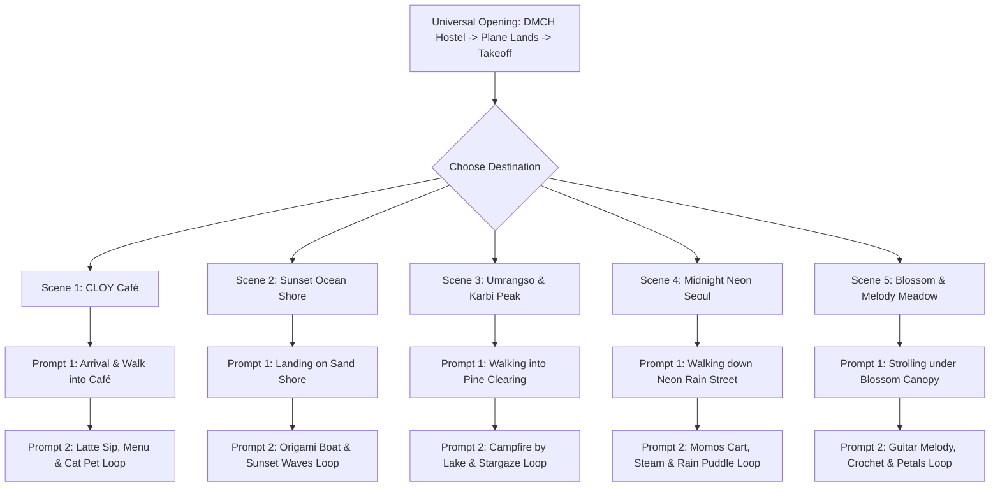

# 🎬 Lin's Escape: Complete Production Video Prompt Master Guide

This master prompt sheet contains the **exact, production-grade video generation prompts** for all 5 escape worlds. 

Every scene consists of **2 sequential prompts**:
1. **Prompt 1 (Arrival & Entering the Space)**: From the flight in the clouds, cutting to the destination as **Lin** walks into the environment, explores, and takes her seat/position.
2. **Prompt 2 (Ambient Interactive Action Loop)**: Directly continuing from Prompt 1, showing Lin performing specific micro-actions (reading the menu, sipping warm chai/latte, petting cat, releasing origami boat, enjoying the campfire by Umrangso lake, listening to acoustic music, crocheting with red yarn) while the camera performs a smooth ambient loop.

---

## 🎨 Universal Character Consistency Anchor
*(Every AI video model should have this exact character definition included to maintain 100% visual consistency across all clips).*

> **Character Sheet (Lin / Talinbon):**
> "A charming young anime medical student girl (Lin), cute Northeast Indian / Karbi background, soft dark wavy hair with gentle curtain bangs, warm expressive dark eyes, cute small round glasses (often joking 'I'm blind 🫥'). Wearing an oversized cozy cream-and-navy knit cardigan or pastel mint sweater over a simple tee, with a tiny red-and-blue crochet Spider-Man keychain charm. Whimsical Studio Ghibli and Makoto Shinkai anime character design, clean expressive cel-shading, consistent anatomy."

---



---

## ☕ Scene 1: Cozy CLOY & Goblin Café

### 🎬 Context for AI:
> *Universal opening has concluded: The skyplane has carried Lin away from DMCH medical postings into soft rainy twilight clouds. The scene now cuts directly to the ground level outside a charming artisan café in the rain.*

### 📽️ Prompt 1.1: Arrival & Walking into the Café
```text
Art Style: Studio Ghibli and Makoto Shinkai feature film cinematography.
Scene & Action: The camera opens on the outside of a rustic wooden coffee shop (CLOY Café) during a gentle twilight rain. The front wooden door with a brass bell opens, and Lin (young anime medical student with dark hair, gentle curtain bangs, round glasses, oversized cream knit cardigan) steps inside out of the rain, shaking glistening raindrops from her sleeves. She looks around the warm interior with a relieved, happy smile. She walks past vintage dark wood bookshelves and glowing hanging amber Edison lamps toward an empty corner window booth with soft cushioned seats.
Camera Movement: Smooth third-person tracking camera following Lin as she enters through the doorway, glides through the warm aisle, and sits down at the polished wooden window table.
Lighting: Warm golden amber indoor lighting contrasting with cool blue-lavender twilight rain outside the large glass window. Ultra-detailed 4K, 60fps.
```

### 📽️ Prompt 1.2: Ambient Interactive Action Loop
```text
Art Style: Studio Ghibli warmth, tranquil lofi anime animation.
Scene & Action: Lin sits comfortably at the window booth of the café. On the dark mahogany table sits a steaming ceramic mug with cute cat foam latte art. A gentle sleeping ginger cat is curled up beside her on the bench. Lin picks up the warm mug with both hands, breathes in the rich aroma, and takes a soothing sip, her face melting into total relaxation. Outside, raindrops tap gently on the large glass pane, blurring golden city lights into soft bokeh.
Camera Movement: Subtle cinematic slow breathing zoom with micro-parallax drift around Lin and the steaming mug. Seamless ambient loop.
```

---

## 🌊 Scene 2: Sunset Ocean Shore

### 📽️ Prompt 2.1: Landing on Sand Shore
```text
Art Style: Makoto Shinkai coastal realism with vibrant anime lighting.
Scene & Action: The pastel yellow skyplane descends smoothly onto the edge of a pristine white sand beach at peak golden sunset. The cockpit opens, and Lin steps onto the soft powdery sand. She slips off her shoes, smiling as gentle, warm turquoise foam washes across her bare feet. Ahead, a charming red-and-white lighthouse stands proudly on coastal cliffs.
Camera Movement: Low-angle tracking shot gliding smoothly along the shoreline as Lin walks peacefully along the water's edge.
```

### 📽️ Prompt 2.2: Origami Boat & Sunset Waves Loop
```text
Art Style: Radiant golden hour anime coastal masterwork.
Scene & Action: Lin kneels gently on the warm golden sand where translucent turquoise waves meet the shore. In her hands, she gently places a delicate white origami paper boat onto the water. She gives it a soft nudge, watching it bob peacefully on the sparkling ripples into the pastel pink and orange sunset horizon.
Camera Movement: Smooth orbital slow-motion glide around Lin and the floating origami boat.
```

---

## 🌲 Scene 3: Umrangso & Karbi Starlit Peak

### 📽️ Prompt 3.1: Walking into Pine Clearing
```text
Art Style: Breathtaking high-altitude nocturnal anime realism.
Scene & Action: The skyplane settles softly into a pine needle meadow high in the hills overlooking Umrangso lake. Lin, wrapped in a cozy woven Karbi pattern shawl, steps out onto the pine-scented earth. A crackling stone-ring campfire illuminates the clearing with dancing golden-orange embers floating into the cool night air.
Camera Movement: Cinematic upward crane shot transitioning from Lin walking toward the fire to revealing the turquoise lake and shimmering emerald aurora overhead.
```

### 📽️ Prompt 3.2: Campfire by Lake & Stargaze Loop
```text
Art Style: Makoto Shinkai cosmic night sky masterwork.
Scene & Action: Lin sits comfortably on a smoothed cedar log by the crackling campfire, wrapped in her Karbi shawl. She cradles a tin mug of hot tea, watching sparks drift upward toward an emerald-green aurora borealis ribbon waving across the Milky Way.
Camera Movement: Slow circular pan around Lin and the crackling fire, with stars twinkling and aurora ribbons dancing in real-time.
```

---

## 🌃 Scene 4: Midnight Neon Seoul

### 📽️ Prompt 4.1: Walking down Neon Rain Street
```text
Art Style: Cyberpunk and Makoto Shinkai midnight aesthetic.
Scene & Action: The yellow skyplane touches down quietly on a rain-slicked boulevard in Seoul at midnight. Lin, wearing a stylish oversized jacket and white wireless headphones, steps out with an umbrella. The wet asphalt reflects vibrant magenta, cyan, and amber neon signs. Ahead, a traditional wooden food stall glows warmly under red paper lanterns.
Camera Movement: Third-person tracking shot gliding through gentle rain puddles with concentric water ripples.
```

### 📽️ Prompt 4.2: Momos & Broth Stall Loop
```text
Art Style: Cozy midnight street food anime cinematography.
Scene & Action: Lin sits at the open wooden counter of the street food stall under a red canvas awning. In front of her, bamboo steamers release clouds of fragrant steam revealing piping hot momos and dumplings. Lin picks up a juicy momo with chopsticks, smiling with sheer delight as lo-fi music plays in her headphones.
Camera Movement: Warm medium close-up with soft neon bokeh drifting in the background.
```

---

## 🌸 Scene 5: Blossom & Melody Meadow

### 📽️ Prompt 5.1: Strolling under Blossom Canopy
```text
Art Style: Pure Studio Ghibli sunlit summer bliss.
Scene & Action: The skyplane glides across rolling emerald-green hills, touching down softly near a colossal ancient cherry blossom tree. Lin steps out into the warm summer breeze. Thousands of delicate pink petals drift from the branches, swirling like snow through golden sunbeams breaking through the canopy.
Camera Movement: Expansive panoramic sweep following Lin as she approaches a cozy picnic blanket with an acoustic guitar resting on it.
```

### 📽️ Prompt 5.2: Guitar Melody, Crochet & Petals Loop
```text
Art Style: Heartwarming, joyous anime nature cinematography.
Scene & Action: Lin sits cross-legged on a checkered picnic blanket beneath the giant cherry blossom tree. An acoustic guitar rests against her lap, and colorful skeins of red and pastel yarn sit beside a handmade chibi crochet Spider-Man. She strums a soft, beautiful chord on the guitar, smiling with genuine confidence and happiness as pink petals swirl around her.
Camera Movement: Slow 360-degree orbital rotation around Lin, capturing fluttering petals and golden lens flares.
```
