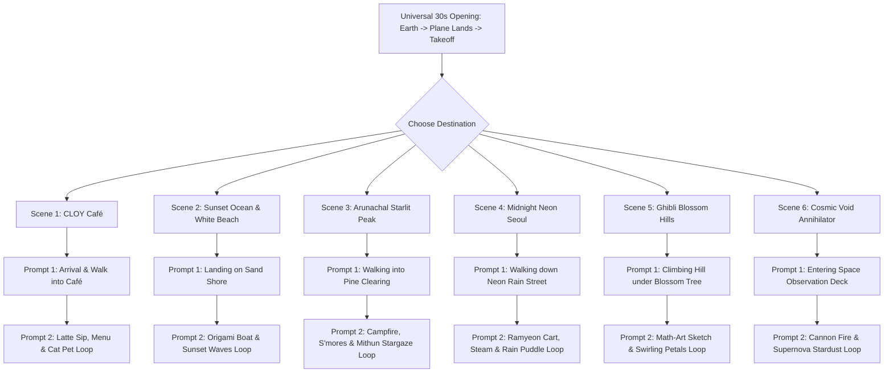

# 🎬 Dadaji's Escape: Complete Production Video Prompt Master Guide

This master prompt sheet contains the **exact, production-grade video generation prompts** for all 6 escape worlds. 

Every scene consists of **2 sequential prompts**:
1. **Prompt 1 (Arrival & Entering the Space)**: From the flight in the clouds, cutting to the destination as **Dadaji** walks into the environment, explores, and takes her seat/position.
2. **Prompt 2 (Ambient Interactive Action Loop)**: Directly continuing from Prompt 1, showing Dadaji performing specific micro-actions (reading the menu, sipping latte, petting cat, releasing paper boat, roasting marshmallow, sketching math flower) while the camera performs a smooth ambient loop.

---

## 🎨 Universal Character Consistency Anchor
*(Every AI video model should have this exact character definition included to maintain 100% visual consistency across all clips).*

> **Character Sheet (Dadaji):**
> "A charming young anime university girl (Dadaji), warm amber-brown hair tied in a loose relaxed ponytail with soft side bangs, gentle expressive hazel-brown eyes. Wearing an oversized cozy cream-and-navy knit cardigan over a pastel lilac shirt, comfortable dark trousers, and carrying a small sage-green backpack with a tiny white cat keychain. Whimsical Studio Ghibli and Makoto Shinkai anime character design, clean expressive cel-shading, consistent anatomy."

---



---

## ☕ Scene 1: Cozy CLOY Café

### 🎬 Context for AI:
> *Universal opening has concluded: The skyplane has carried Dadaji away from college into soft rainy twilight clouds. The scene now cuts directly to the ground level outside a charming European/Korean artisan café in the rain.*

### 📽️ Prompt 1.1: Arrival & Walking into the Café
```text
Art Style: Studio Ghibli and Makoto Shinkai feature film cinematography.
Scene & Action: The camera opens on the outside of a rustic wooden coffee shop (CLOY Café) during a gentle twilight rain. The front wooden door with a brass bell opens, and Dadaji (young anime girl with loose brown ponytail, oversized cream knit cardigan, green backpack) steps inside out of the rain, shaking a few glistening raindrops from her sleeves. She looks around the warm, cozy interior with a relieved, happy smile, taking off her backpack. She walks past vintage dark wood bookshelves and glowing hanging amber Edison lamps toward an empty corner window booth with soft cushioned seats.
Camera Movement: Smooth third-person tracking camera following Dadaji as she enters through the doorway, glides through the warm aisle, and sits down at the polished wooden window table.
Lighting: Warm golden amber indoor lighting contrasting with cool blue-lavender twilight rain outside the large glass window. Ultra-detailed 4K, 60fps, realistic depth of field.
```

### 📽️ Prompt 1.2: Ambient Action Loop (Menu, Latte & Sleeping Cat)
```text
Art Style: Studio Ghibli cozy interior aesthetic, flawless temporal loop.
Previous Context: Dadaji is now seated comfortably in the window booth of CLOY Café with rain falling outside.
Scene & Action: Dadaji picks up a small wooden chalkboard menu on the table reading "Chef Dadaji's Michelin Smoked Potatoes — Curfew Repealed", giggles softly, and places it back down. She then takes a warm ceramic mug with both hands, gently blowing on the volumetric steam rising from the cat foam latte art and taking a comforting sip. On the windowsill beside her, a chubby ginger cat is curled up asleep; Dadaji gently reaches out and strokes the cat's soft fur, causing the cat to stretch and purr softly.
Camera Movement: Continuous slow, relaxing 180-degree circular orbit around the table, focusing between the steaming coffee mug, Dadaji's relaxed smile, the purring cat, and the rainy window glass with blurred glowing neon bokeh.
Atmosphere: Curling coffee steam, raindrops sliding on glass, warm lamp glow, 4K UHD, 60fps seamless ambient loop.
```

---

## 🌊 Scene 2: Sunset Ocean Shore & White Beach

### 🎬 Context for AI:
> *Universal opening has concluded: The skyplane glides over pastel pink clouds and descends toward a tranquil golden sunset coastline.*

### 📽️ Prompt 2.1: Arrival & Walking to the Shoreline
```text
Art Style: Studio Ghibli coastal animation (Ponyo / Porco Rosso ocean flight aesthetic).
Scene & Action: The camera cuts to a pristine tropical white sand beach at golden hour sunset. Dadaji (young anime girl, brown ponytail, cream cardigan, dark trousers) is seen walking barefoot onto the soft warm sand, carrying her shoes in one hand. She walks past a charming weathered wooden signpost reading "🏝️ Secret Portal: White Beach — Zero Deadlines". She steps gently toward the water's edge as calm turquoise ocean waves with translucent foam lap against her feet. She takes a deep breath of the ocean breeze and sits down comfortably on the warm sand overlooking the glowing horizon.
Camera Movement: Wide cinematic low-angle tracking shot following Dadaji from behind as she walks across the sand toward the water, gently panning around to reveal the vast golden ocean sunset.
Lighting: Brilliant warm honey-gold, peach, and lavender sunset reflections across the water. 4K, 60fps.
```

### 📽️ Prompt 2.2: Ambient Action Loop (Origami Boat & Golden Waves)
```text
Art Style: Breathtaking Makoto Shinkai coastal scenery, seamless video loop.
Previous Context: Dadaji is seated on the white sand at the water's edge during golden sunset.
Scene & Action: Dadaji folds a small white origami paper boat labeled "2 AM Assignments" and gently places it on the incoming tide. The water lifts the paper boat, carrying it peacefully out to sea toward the glowing sunset sun. Dadaji hugs her knees with a serene smile, watching it sail away. In the distant background, a white-and-red lighthouse on coastal cliffs rotates its golden beam into the sea haze while a pair of seagulls glide overhead on the warm breeze.
Camera Movement: Slow, rhythmic cinematic drift forward and tilt up from the bobbing origami boat on the sparkling ripples toward Dadaji and the expansive glowing sunset horizon.
Physics: Translucent wave foam receding on wet reflective sand, floating origami buoyancy, golden sun glints, 4K UHD, 60fps loop.
```

---

## 🌲 Scene 3: Arunachal Starlit Peak & Campfire

### 🎬 Context for AI:
> *Universal opening has concluded: The skyplane ascends over high Himalayan mountain mist into an emerald-green Aurora Borealis sky.*

### 📽️ Prompt 3.1: Arrival & Walking into the Pine Clearing
```text
Art Style: Makoto Shinkai cosmic night realism and Studio Ghibli nature aesthetic.
Scene & Action: The scene opens in a high-altitude alpine pine clearing in Arunachal Pradesh under a dark indigo sky illuminated by a glowing emerald-green Aurora Borealis ribbon and millions of Milky Way stars. Dadaji (young anime girl with brown ponytail, wrapped in a warm geometric patterned tribal shawl over her knit cardigan) walks through the pine trees into the clearing. She notices a crackling stone-ring campfire in the center and a majestic, gentle dark-coated Mithun cattle with iconic white stocking feet resting calmly nearby. She smiles with awe, walking over to sit on a smooth wooden log by the warm fire.
Camera Movement: Smooth cinematic crane shot descending through the pine canopy, tracking Dadaji as she enters the clearing and settles by the crackling campfire.
Lighting: Vibrant emerald aurora light dancing in the sky contrasting with the deep warm orange glow of the campfire. 4K, 60fps.
```

### 📽️ Prompt 3.2: Ambient Action Loop (Campfire S'mores, Mithun & Shooting Stars)
```text
Art Style: Hyper-detailed anime night sanctuary, flawless temporal loop.
Previous Context: Dadaji is sitting on the log beside the crackling campfire, with the friendly Mithun resting nearby under the starry sky.
Scene & Action: Dadaji holds a wooden roasting skewer with a golden toasted marshmallow over the campfire flames, smiling as sparks pop. She takes a warm enamel mug of mountain herbal tea, blowing on the steam. Beside the fire, the friendly Mithun blinks its large gentle eyes and sways its head peacefully. Suddenly, a brilliant shooting star blazes across the Milky Way and Aurora ribbon, scattering sparkling light dust across the sky as Dadaji looks up in quiet wonder.
Camera Movement: Slow, continuous 360-degree orbital camera circling around the glowing campfire, capturing Dadaji, the crackling embers, the peaceful Mithun, and the shooting stars streaking overhead.
Physics & Atmosphere: Floating glowing embers rising into the night, waving aurora waves, crisp mountain air, 4K UHD, 60fps loop.
```

---

## 🌃 Scene 4: Midnight Neon Seoul & Ramyeon Stall

### 🎬 Context for AI:
> *Universal opening has concluded: The skyplane glides down between modern city skyscrapers glowing in colorful neon lights during a gentle midnight rain.*

### 📽️ Prompt 4.1: Arrival & Walking Down Rain-Slicked Neon Street
```text
Art Style: Cyberpunk K-Drama aesthetic, Makoto Shinkai wet asphalt cinematography.
Scene & Action: The camera opens on a quiet, atmospheric pedestrian street in Seoul at midnight during gentle rainfall. Dadaji (young anime girl, brown ponytail, knit cardigan, holding a clear transparent umbrella) walks down the shiny wet sidewalk. The asphalt glistens with mirror reflections of vibrant pink, cyan, and amber neon signs reading "CLOY 24/7", "97% Spotify Blend", and "11:00 PM Curfew Repealed". Dadaji looks at the neon reflections with a relaxed expression, stepping past clear water puddles toward a traditional street food cart sheltered under a glowing red fabric canopy.
Camera Movement: Smooth third-person tracking shot following behind and beside Dadaji as she walks under her umbrella down the glowing neon street toward the ramyeon stall.
Lighting: High-contrast wet reflections, colorful neon bloom, raindrops catching streetlamp light. 4K, 60fps.
```

### 📽️ Prompt 4.2: Ambient Action Loop (Ramyeon Cart, Steaming Broth & Rain)
```text
Art Style: Studio Ghibli comfort food styling, Makoto Shinkai rainy night loop.
Previous Context: Dadaji has sat down on a wooden stool under the red canopy of the street ramyeon cart, out of the rain.
Scene & Action: Dadaji rests her transparent umbrella against the cart counter. The chef places a hot, bubbling stone bowl of freshly cooked spicy ramyeon with soft egg and scallions in front of her. Dadaji happily snaps her wooden chopsticks, taking a bite and blowing on the steam with a joyful smile. Red paper lanterns sway gently above the counter, casting a warm vermilion glow while peaceful rain trickles down the canopy edge into puddles on the neon-lit street behind her.
Camera Movement: Slow, intimate push-in and gentle horizontal pan focusing on the steaming noodle bowl, Dadaji's happy expression, and the falling rain droplets rippling in the background puddles.
Atmosphere: Rising broth steam, rain soundscape visuals, swinging red lanterns, 4K UHD, 60fps loop.
```

---

## 🌸 Scene 5: Ghibli Blossom Hills & Math-Art Studio

### 🎬 Context for AI:
> *Universal opening has concluded: The skyplane glides over endless rolling green hills under a bright, sunny blue summer sky.*

### 📽️ Prompt 5.1: Arrival & Walking up the Blossom Hill
```text
Art Style: Masterpiece Studio Ghibli nature animation (Howl's Moving Castle / Wind Rises aesthetic).
Scene & Action: The camera opens on vast rolling emerald-green hills dotted with yellow and violet wildflowers under a brilliant blue sky with sunlit cumulus clouds. Dadaji (young anime girl, brown ponytail, knit cardigan, white sneakers) is walking joyfully up a grassy slope toward a colossal ancient cherry blossom tree on the hilltop in full pink bloom. A warm summer breeze blows through the tall grass, carrying thousands of floating dandelion seeds and delicate pink petals. Dadaji reaches the summit, placing her hands on the sturdy tree trunk and gazing out at the breathtaking sun-drenched valley.
Camera Movement: Sweeping aerial crane shot starting low behind Dadaji as she climbs the grassy hill, rising smoothly up to reveal the massive blossoming cherry tree and panoramic meadow landscape.
Lighting: Warm golden summer sunlight, God rays filtering through branches, vibrant natural colors. 4K, 60fps.
```

### 📽️ Prompt 5.2: Ambient Action Loop (Math-Art Sketching & Petal Vortex)
```text
Art Style: Surreal mathematical anime fantasy, Makoto Shinkai celestial lighting.
Previous Context: Dadaji is sitting cross-legged on the soft grass beneath the giant blooming cherry blossom tree.
Scene & Action: Dadaji has an open sketchbook on her lap, drawing an intricate floral spiral curve with a pencil. In the air above the tree, floating iridescent 3D mathematical parametric flower sculptures (Torus knots and Rose curves) rotate gracefully, glowing with crystalline rainbow light. A sudden gust of wind sweeps through the blossom canopy, sending a spiral vortex of pink cherry petals dancing around Dadaji. She looks up from her sketchbook, catching a falling pink petal in her palm with a peaceful smile.
Camera Movement: Smooth 360-degree rotating orbit around Dadaji sitting beneath the tree, capturing the swirling petals, the floating geometric flower art, and the sunlit valley in the background.
Physics: Swirling petal fluid dynamics, drifting dandelion seeds, rustling grass blades, 4K UHD, 60fps loop.
```

---

## 🚀 Scene 6: Cosmic Void & Assignment Annihilator

### 🎬 Context for AI:
> *Universal opening has concluded: The skyplane activates cyan thrusters and ascends beyond Earth's atmosphere into zero-gravity deep space.*

### 📽️ Prompt 6.1: Arrival & Entering the Space Observation Platform
```text
Art Style: Grand sci-fi anime space opera, Makoto Shinkai cosmic scale (Interstellar / Your Name meteor visual).
Scene & Action: The camera opens inside a futuristic glass-domed metallic observation platform floating in deep zero-gravity space. Dadaji (young anime girl with brown hair, wearing a sleek futuristic jacket over her cardigan) steps onto the glowing holographic floor ring. Through the massive panoramic glass dome ahead is a colossal, breathtaking cosmic Black Hole with a spinning accretion disk glowing in intense cyan, electric blue, and magenta plasma rings. Dadaji walks forward to a futuristic laser cannon console labeled "KUCH BHI — Stress Destroyer", looking out at the cosmic nebula in awe.
Camera Movement: Slow forward dolly tracking Dadaji as she walks down the metallic catwalk toward the glowing glass observation deck and cannon controls.
Lighting: Vibrant cyan and magenta plasma bloom reflecting off metallic surfaces, starry background nebula. 4K, 60fps.
```

### 📽️ Prompt 6.2: Ambient Action Loop (Cannon Fire & Supernova Fireworks)
```text
Art Style: Vibrant cosmic fantasy realism, flawless sci-fi temporal loop.
Previous Context: Dadaji is standing at the glowing holographic controls of the space cannon overlooking the Black Hole.
Scene & Action: Dadaji presses a large glowing cyan button on the console. The futuristic cannon fires a barrage of glowing geometric assignment missiles and paperwork cubes directly into the Black Hole accretion disk. As the missiles hit the event horizon, they vaporize into an explosive shockwave of glittering pastel stardust, golden sparkles, and colorful cosmic fireworks that ripple across space. Dadaji laughs triumphantly, leaning back against the console with a satisfied smile.
Camera Movement: Slow cinematic pull-back and orbital drift around Dadaji at the console as colorful stardust shockwaves expand smoothly into deep space.
Physics & Atmosphere: Zero-G particle fireworks, spinning plasma rings, glowing nebula dust, 4K UHD, 60fps loop.
```

---

## 💡 Recommended Generation Settings for AI Video Tools
* **Model:** Runway Gen-3 Alpha, Luma Dream Machine, or Kling AI (1.5 / Pro).
* **Resolution:** 4K UHD (or 1080p upscaled to 4K via Upscayl / Real-ESRGAN).
* **Aspect Ratio:** `16:9` (`3840x2160`).
* **Duration:** 10 seconds per clip (chained sequentially using Image-to-Video continuation).
* **Motion Strength:** `0.45 – 0.55` (keeps motion smooth, cinematic, and non-jittery).
